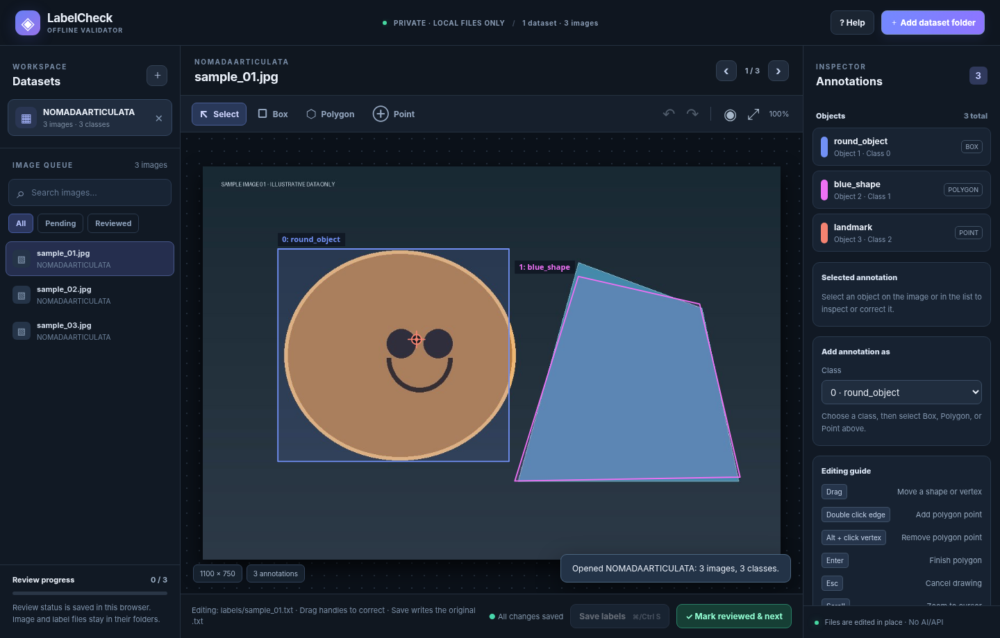

# LabelCheck — Offline YOLO Annotation Validator

**A free, local annotation review tool for Windows and macOS.** Open an existing dataset, see its YOLO annotations over each image, fix bounding boxes or polygon vertices, and save corrections directly into the original `.txt` labels.

No Gemini API key, no cloud upload, no account, no Node.js. **Python is optional.**



**[▶ Watch the two-minute demo (MP4)](demo.mp4)** · [Quick start](#quick-start-no-python-required) · [Python/Terminal setup](#run-through-terminal-with-python) · [Review instructions](#how-to-review-annotations)

> The video is stored in this repository. GitHub may offer it as a download rather than an embedded video player.

## Quick start (no Python required)

1. At the top of this GitHub page, click the green **Code** button → **Download ZIP**.
2. Find the ZIP in **Downloads** and extract it (Mac: double-click; Windows: right-click → **Extract All**).
3. Open the extracted folder. Find `index.html`.
4. Right-click `index.html` → **Open With → Google Chrome** or **Microsoft Edge**.
5. Click **Add dataset folder** and select your full dataset folder (e.g. `NOMADAARTICULATA`, **not** its `images` subfolder).
6. Allow Chrome/Edge to read and edit the selected folder. You can now review and save annotations.

**Use Chrome or Edge.** Safari and Firefox are not supported for direct local-folder writing. If the browser blocks folder access when you open `index.html` directly, use the Python/Terminal method below.

## Run through Terminal with Python

Python here runs a tiny local HTTP server that serves the UI only to your computer. The application still reads and writes dataset files locally, inside your browser.

### macOS — complete beginner guide

**Step 1. Open Terminal:** Press `Command + Space`, type `Terminal`, press **Enter**.

**Step 2. Check Python:**

```bash
python3 --version
```

If you see `Python 3.x.x`, you're ready. If the command isn't available, download Python from the **[official macOS Python downloads](https://www.python.org/downloads/macos/)**, install it, reopen Terminal, and try again. Homebrew users can alternatively run `brew install python`.

**Step 3. Download the code:** On this GitHub page click **Code → Download ZIP** and extract it in Downloads.

**Step 4. Open that folder in Terminal:** Type `cd ` (including the space), drag the extracted folder from Finder into the Terminal window, and press **Enter**. It might look like:

```bash
cd ~/Downloads/LabelCheck-main
```

Check you're in the right folder:

```bash
ls
```

You should see `index.html`, `app.js`, `model.js` and `styles.css`.

**Step 5. Start the application:**

```bash
python3 -m http.server 8765 --bind 127.0.0.1
```

It should print something like `Serving HTTP on 127.0.0.1 port 8765`.

**Step 6. Open Chrome** and enter **http://127.0.0.1:8765** into the address bar. Or open a second Terminal tab and run:

```bash
open -a "Google Chrome" http://127.0.0.1:8765
```

Keep the first Terminal window open during use. To stop the server, press **Control + C** (not Command + C).

### Windows 10/11 — complete beginner guide

**Step 1. Check for Python:** Press the **Windows** key, type `PowerShell`, open it, and run:

```powershell
python --version
```

If that fails, try `py --version`.

**Step 2. Install Python if necessary:** Download from the official **[Python for Windows](https://www.python.org/downloads/windows/)** page. Follow the installation wizard. If using an installer that offers **Add Python to PATH**, enable it. Reopen PowerShell after installation, and recheck `python --version` or `py --version`. See the [official Windows Python setup guide](https://docs.python.org/3/using/windows.html) if needed.

**Step 3. Download and extract** this repository (green **Code → Download ZIP → Extract All**).

**Step 4. Open PowerShell in the app folder:** Open the extracted folder in File Explorer, click the address bar, type `powershell`, and press **Enter**.

**Step 5. Start the app:**

```powershell
python -m http.server 8765 --bind 127.0.0.1
```

If only `py --version` worked, use:

```powershell
py -m http.server 8765 --bind 127.0.0.1
```

**Step 6. Open Chrome or Edge**, then visit **http://127.0.0.1:8765**. Keep PowerShell open; press **Ctrl + C** to stop when you're finished.

### VS Code users

Open the extracted project folder in **VS Code → File → Open Folder**. Open **Terminal → New Terminal** and run the same Python command for your OS above. Open `http://127.0.0.1:8765` in Chrome or Edge. No `pip install`, `npm install`, virtual environment, or build process is needed.

## What dataset folder should I select?

Choose the **parent directory** that contains both `images` and `labels`:

```text
NOMADAARTICULATA/
├── classes.txt            # one class name per line, starting at class 0
├── notes.json             # optional: not modified by this tool
├── images/
│   ├── bee001.jpg
│   └── bee002.jpg
└── labels/
    ├── bee001.txt
    └── bee002.txt
```

Image and label basenames must match: `images/bee001.jpg` corresponds to `labels/bee001.txt`. Nested paths are supported too: `images/train/bee001.jpg` → `labels/train/bee001.txt`.

You can add several datasets one at a time. **For your first trial, copy your real dataset and test on the copy.** You can also practice safely with the included `sample_dataset` (three synthetic images and labels).

## How to review annotations

1. Click **Add dataset folder**, choose the dataset root, and approve the local read/write permission.
2. Click an image in the left panel. Existing annotations appear over it.
3. Examine the shapes and class names for incorrect placement or class labels.
4. Select the shape and correct it: move/resize boxes, drag polygon points, or change its class from the right inspector.
5. Click **Save labels** or press `Command+S` on Mac / `Ctrl+S` on Windows.
6. Click **Mark reviewed & next** to advance through the image queue. This also saves any pending edits first.

| Action | How to do it |
|---|---|
| Select or move an existing shape | Press `V`, click/drag the shape |
| Resize a bounding box | Select box, drag a corner handle |
| Correct a polygon vertex | Select polygon, drag a white point |
| Add a polygon vertex | Double-click a polygon edge |
| Remove a polygon vertex | `Alt + click` on point (minimum 3 remain) |
| Add a box | Press `B`, click and drag |
| Add a polygon | Press `G`, click vertices, press `Enter` |
| Add a point | Press `P`, click its location |
| Change an object's class | Select object → change **Class** in the right inspector |
| Delete selected annotation | Press `Delete` (or inspector **Delete**) |
| Undo / redo | `Ctrl/⌘+Z` / `Ctrl/⌘+Shift+Z` |
| Previous / next image | `J` / `K` |
| Zoom / fit image | Mouse wheel / `F` |
| Hide/show annotation overlays | `O` |
| Cancel current drawing | `Esc` |

### What happens to my files?

- `images/bee001.jpg` is **not** changed. Saving updates only `labels/bee001.txt` in place.
- The first time an existing nonempty `.txt` is overwritten, its original contents are backed up under `labels/.labelcheck-backups/bee001.txt.bak`. Future saves keep that original backup unchanged.
- If the file changes in another application during the session, LabelCheck asks before overwriting it.
- **Review status is stored in your current browser, not in the dataset**. It does not synchronize across validators. The actual shared work is the updated `.txt` labels.
- Annotators do **not** have to upload images or annotation folders to GitHub. They only download this app and open their own local dataset.

## Supported annotation formats

LabelCheck supports **normalized YOLO detection boxes**, **YOLO segmentation polygons**, and a simple **class + x + y point format** (all coordinates between `0` and `1`):

```text
# Detection: class center_x center_y width height
0 0.50 0.50 0.30 0.40

# Segmentation: class x1 y1 x2 y2 x3 y3 ...
1 0.10 0.10 0.85 0.12 0.60 0.80

# Single point: class x y
2 0.38 0.48
```

Unsupported rows such as full YOLO pose/keypoint labels are **preserved unchanged and flagged**, but cannot be edited graphically. This version does not edit COCO JSON, raw pixel coordinates, or image masks. It does not run AI detection.

## Troubleshooting

**Browser won't open dataset folder:** Use an up-to-date Chrome or Edge; allow local read/write access. If you opened `index.html` directly, try the Python server method above.

**Image opens but annotations are missing:** Check `labels/bee001.txt` exists for `images/bee001.jpg` and that coordinates are normalized YOLO format. Check the right-panel warning about unsupported rows.

**`python` or `python3` not found:** Install Python 3 from python.org, close and reopen Terminal/PowerShell, and check the version again.

**Port 8765 is busy:** Stop your old local server with `Ctrl+C` or change both the command and the browser URL to port `8766`.

**Permission denied while saving:** Ensure the chosen dataset is writable and the browser was granted local folder access. Try a copy placed in Downloads.

**Can multiple people work on it?** Yes, each validator uses their own copy of the app and data. However, review status is local and independently edited `.txt` files must be merged manually.

**Restore an earlier label:** In `labels/.labelcheck-backups/`, find the matching `.bak`; copy its contents back to the original `.txt` after making a copy of the current label if needed.

## Contents and development

| File | Purpose |
|---|---|
| `index.html`, `styles.css` | App layout and appearance |
| `app.js`, `model.js` | Image editor, local folder access, YOLO parsing/writing |
| `sample_dataset/` | Practice dataset (not real data) |
| `demo.mp4`, `app_preview.png` | Demo and screenshot |
| `test_model.js` | Optional parser tests; run `node test_model.js` if you have Node.js |

The app is plain HTML, CSS, and JavaScript. No installation or build process is required. Licensed under the [MIT License](LICENSE).
